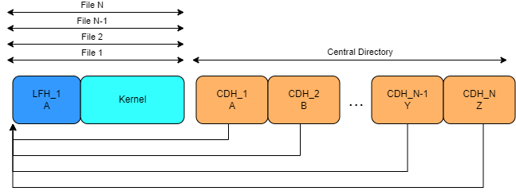
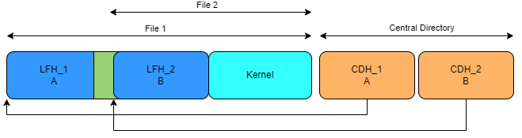

# Task 1

Now that we understand the basic structure of the zip format, we can move on to constructing a zip bomb.

We want the file data to be as compressed as possible, preferably close to the maximum compression ratio possible. For DEFLATE, the compression algorithm most often used in zip files, the theoretical maximum compression ratio is 1032 (the uncompressed size is 1032 times larger than the compressed size). To come very close to the limit, the data should just be a long string of repeating bytes.

## Basic idea

We want to trick the unzip program to believe that the zip consists of many
compressed files, despite only consisting of one compressed file. The basic idea
is to create a number of central directory headers, each one pointing to the
same data. Creating `N` central directory headers would thus create N
overlapping files. During decompression, the file data would then be decompressed N times taking the maximum compression ratio from 1032 to 1032N.

Unfortunately, just having several central directory headers pointing to the same local file header will result in mismatching file names, resulting in errors in most unzip programs.

## Solution

The solution requires a small amendment. We will add non-compressed blocks. These blocks start with a 5 byte non-compressed-block header containing a length field specifying that the following n bytes should be written as is. The length field should specify the size of the following header.

## Your task

Create a zip bomb with two layers. That is, it should contain two Central directory headers and two local file headers as well as use a non-compressed block as represented in the figure.

## Execution the tutorial

You can verify that your code passes the tests by running
`python3 -m test` in this directory.

To check the size of your zip, you can run `python3 ../unzip/safe_unzip.py zip_bomb.zip `in this directory. A passing solution should unzip with
no errors.

Verify your solution using [`safe_unzip.py`](../unzip/). A passing solution should unzip with no errors and achieve a compression ratio of at least 1800.
