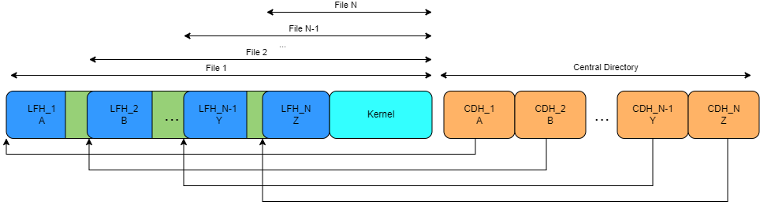

## Task 2

Now you have manually constructed a zip-bomb with two layers. Your next task is to create a dynamic program that takes the variable `number_of_layers` and creates a zip-bomb with the corresponding amount of layers. You may reuse your code from the previous tasks in this lab.

## Execution the tutorial

You can verify that your code passes the tests by running
`python3 -m test` in this directory.
A passing solution
should unzip with no errors and achieve a compression ratio of at least 10000.

To check the size of your zip, you can run `python3 ../unzip/safe_unzip.py zip_bomb.zip `in this directory. A passing solution should unzip with
no errors.
