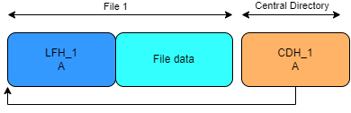

# Tutorial

Zip bombs take advantage of the poorly specified zip file format ([APPNOTE.txt](https://pkware.cachefly.net/webdocs/APPNOTE/APPNOTE-6.3.10.TXT)). To become familiar with zip files and how they are structured, the first task is to manually create a regular zip with one file in it.

## Zip file structure

According to the specification, the most basic zip file has the following file format:

```text
[local file header 1]
[file data 1]
.
.
.
[local file header n]
[file data n]
[central directory header 1]
.
.
.
[central directory header n]
[end of central directory record]
```

Here, the `file data` blocks are the individual compressed files stored within the zip. Each file has a `local file header` containing information needed to decompress the data and verify the integrity of the uncompressed file.

Below all the `local file header`-`file data` pairs lies the central directory. The central directory has a `central directory header` for each compressed file. The `central directory header`s contain file information as well as a pointer to the corresponding `local file header`. Last comes the `end of central directory record` which points to the beginning of the central directory (`central directory header 1`).

When you unzip a zip file the program will begin by locating the `end of central directory record` and follow the reference to the first central directory header. From there it can follow the reference to the local file header and decompress the file data as specified in the headers. After it has finished unpacking the first file it verifies its integrity and then moves on to the next central directory header.

## Creation of a simple zip file

[commons](../shared/commons.py) provides you with functions to easily generate
all the components needed in a zip file (`local file header`, `file data`,
`central directory header` and `end of central directory header`), saving you
from having to read the entire zip specification.

In [tutorial.py](./tutorial.py) the function `create_zip_file()` assembles a zip with one file in it.

```text
[local file header 1]
[file data 1]
[central directory header 1]
[end of central directory record]
```



## Execution the tutorial

You can run the tutorial code by executing
`python3 -m tutorial` in this directory.

You can verify that the tutorial passes the tests by running
`python3 -m test` in this directory.

To check the size of your zip, you can run `python3 ../unzip/safe_unzip.py zip_file.zip `in this directory. A passing solution should unzip with no errors.
